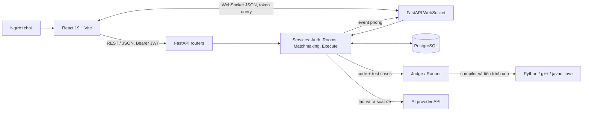

# Cẩm nang ôn tập bảo vệ đồ án CodeDuel AI

> Tài liệu này được đối chiếu với mã nguồn hiện tại trong `backend/` và `frontend/`. Khi trình bày, phân biệt rõ tính năng đã chạy với hướng phát triển. Đặc biệt, AI hiện tạo và rà soát **đề bài/testcase**; chưa có luồng AI phân tích code người chơi sau trận.

## Mục lục

1. [Bài toán và giá trị sản phẩm](#1-bài-toán-và-giá-trị-sản-phẩm)
2. [Kiến trúc hệ thống](#2-kiến-trúc-hệ-thống)
3. [Công nghệ và lý do lựa chọn](#3-công-nghệ-và-lý-do-lựa-chọn)
4. [Các luồng nghiệp vụ end-to-end](#4-các-luồng-nghiệp-vụ-end-to-end)
5. [API và giao thức WebSocket](#5-api-và-giao-thức-websocket)
6. [Điểm nhấn UI/UX](#6-điểm-nhấn-uiux)
7. [Giới hạn hiện tại và hướng phát triển](#7-giới-hạn-hiện-tại-và-hướng-phát-triển)
8. [Gợi ý phân chia phần trình bày cho bốn thành viên](#8-gợi-ý-phân-chia-phần-trình-bày-cho-bốn-thành-viên)
9. [10 câu hỏi phản biện thường gặp](#9-10-câu-hỏi-phản-biện-thường-gặp)

---

## 1. Bài toán và giá trị sản phẩm

### 1.1 Bài toán

Các nền tảng luyện thuật toán truyền thống chủ yếu phục vụ việc giải bài độc lập: người học chọn bài, nộp lời giải, xem kết quả. Cách học đó hữu ích nhưng ít tạo áp lực thời gian, tương tác xã hội và động lực cạnh tranh thường xuyên.

CodeDuel AI thử giải quyết khoảng trống đó bằng một đấu trường 1v1: hai người cùng nhận một đề, viết lời giải trong thời gian giới hạn và được phân định kết quả bởi bộ chấm tự động. Trận Ranked cập nhật rating ELO để tạo động lực luyện tập và phản ánh tương đối trình độ.

### 1.2 Điểm nổi bật

- **Cạnh tranh đồng thời:** hai người chơi cùng một bài và cùng giới hạn thời gian; trạng thái phòng được đồng bộ qua WebSocket.
- **Hai cách tham gia:** ghép Ranked theo rating hoặc thách đấu trong phòng Custom có mã.
- **Kết quả có căn cứ:** Judge thực thi lời giải trên test case và chỉ công nhận thắng khi đạt toàn bộ test case.
- **Đề có thể được tạo tự động:** backend gọi nhà cung cấp AI để tạo đề, sau đó yêu cầu một lượt AI khác rà soát cấu trúc đề/testcase; nếu quy trình AI không dùng được, hệ thống chọn đề dự phòng.
- **Có hồ sơ và tiến trình cạnh tranh:** rating, hạng, tỷ lệ thắng, leaderboard và danh sách trận gần đây.

Điểm khác biệt nên trình bày là **kết hợp trải nghiệm thi đấu realtime với chấm tự động và rating**, không phải tuyên bố thay thế các nền tảng có ngân hàng bài tập lớn. Dữ liệu đề, số lượng người dùng và quy mô hiện phụ thuộc môi trường triển khai.

---

## 2. Kiến trúc hệ thống

### 2.1 Sơ đồ tổng thể

### 2.2 Vai trò các lớp

1. **Frontend (`frontend/public/src`)**
   - React hiển thị Dashboard, xác thực, sảnh đấu, phòng ghép trận và phòng thi đấu.
   - Axios gọi REST API; JWT được thêm vào `Authorization: Bearer ...`.
   - `@monaco-editor/react` cung cấp editor; WebSocket phòng nhận/truyền thông điệp realtime.
   - Trang ghép trận hiện truy vấn `/api/v1/matchmaking/status` định kỳ. Backend cũng có WebSocket matchmaking nhưng giao diện trang này đang dựa vào polling.

2. **FastAPI (`backend/main.py`, `backend/app/routers`)**
   - Routers nhận HTTP/WebSocket, kiểm tra dữ liệu bằng Pydantic và lấy user hiện tại qua dependency.
   - Nghiệp vụ nằm trong `services/`, tách khỏi phần định tuyến.
   - Lifespan khởi tạo metadata bảng, khôi phục timer các trận còn chạy, chạy matchmaking worker và đóng engine khi server dừng.

3. **PostgreSQL**
   - Lưu user, rating, bộ đề/câu hỏi, phòng, người chơi trong phòng, hàng đợi matchmaking và bài nộp.
   - SQLAlchemy async dùng `asyncpg`; Alembic chứa các migration.
   - Không có Redis hoặc dịch vụ cache riêng trong dependency hiện tại. Các connection WebSocket, trạng thái phòng trong lúc chạy và timer được quản lý trong bộ nhớ của tiến trình backend.

4. **Judge/Runner**
   - Lưu code vào thư mục lượt chạy riêng, compile khi cần, sau đó chạy từng testcase trong tiến trình worker.
   - So output sau khi bỏ khoảng trắng ở hai đầu; dừng khi testcase đầu tiên thất bại.
   - Chấm runtime trả trạng thái, số case đạt, thời gian và bộ nhớ; `execute` mới là nơi quyết định chọn public/hidden test, xác thực quyền nộp, lưu submission và kết thúc trận.

5. **AI provider**
   - `ai_client.py` gọi API ngoài từ backend bằng `httpx`; khóa được cấu hình qua `.env` backend.
   - `ai_question_service.py` dùng AI để sinh đề và rà soát đề/testcase.
   - Đây không phải dịch vụ AI phân tích code người chơi sau trận.

### 2.3 Các thực thể dữ liệu quan trọng

| Thực thể | Vai trò |
|---|---|
| `User` | Tài khoản, role, `rating`, `wins`, `rated_games`, avatar |
| `MatchmakingEntry` | Người chơi đang tìm trận, chế độ, trạng thái và phòng được ghép |
| `Room` | Mã phòng, chế độ, trạng thái, đề, người thắng, thời gian và cờ đã áp dụng kết quả |
| `RoomPlayer` | Thành viên phòng, trạng thái sẵn sàng, điểm tiến độ và ELO của trận |
| `Question` / `ProblemSet` | Nội dung đề, giới hạn tài nguyên, test case công khai/ẩn |
| `Submission` | Code, ngôn ngữ, trạng thái chấm, số testcase, số đo và thông tin lỗi đã lọc |

---

## 3. Công nghệ và lý do lựa chọn

Các lý do dưới đây là cách giải thích kiến trúc phù hợp với dự án; không nên khẳng định đã benchmark hoặc chứng minh công nghệ này vượt trội tuyệt đối so với lựa chọn khác.

| Công nghệ | Đang dùng ở đâu | Lý do phù hợp và đánh đổi |
|---|---|---|
| **FastAPI** | REST API, dependency injection, WebSocket, OpenAPI | Một framework Python có kiểu dữ liệu/schema rõ, tích hợp async và hỗ trợ REST lẫn WebSocket trong cùng ứng dụng. Đổi lại, nhóm cần quản lý coroutine, transaction và tác vụ nền cẩn thận. |
| **Pydantic 2** | Request/response schema, settings | Kiểm tra cấu trúc dữ liệu đầu vào/ra và cấu hình môi trường. Giúp endpoint không phải tự parse dữ liệu thủ công; validation không thay thế kiểm tra quyền nghiệp vụ. |
| **SQLAlchemy async + asyncpg** | ORM và truy cập PostgreSQL | ORM giúp ánh xạ user/room/submission sang model; async driver phù hợp với endpoint async và truy vấn I/O. Dùng `FOR UPDATE` ở các thao tác tranh chấp để khóa dữ liệu cần thiết. |
| **Alembic** | Migration schema | Theo dõi thay đổi schema có phiên bản, tiện nâng cấp môi trường. Trong startup hiện tại còn có `Base.metadata.create_all`; tạo bảng bằng `create_all` không thay thế migration thay đổi cấu trúc bảng đã tồn tại. |
| **PostgreSQL** | Lưu dữ liệu chính | Quan hệ user–room–submission, transaction, unique index và row lock phù hợp với nghiệp vụ hàng đợi/kết thúc trận. Chưa có cache phân tán hoặc broker trong cấu hình hiện tại. |
| **React 19** | UI | Component và state cục bộ thuận lợi cho editor, profile, toast và màn hình có trạng thái realtime. Trạng thái phòng authoritative vẫn thuộc backend/DB, không chỉ dựa vào state trình duyệt. |
| **Vite 7** | Dev server/build | Khởi động nhanh, phục vụ module khi phát triển và đóng gói frontend. Vite cấu hình proxy `/api` và WebSocket sang backend localhost. |
| **React Router DOM 7** | Điều hướng trang | Điều hướng giữa các màn hình SPA; ứng dụng dùng thuộc tính `viewTransition` có điều kiện theo thiết lập giảm chuyển động. |
| **Monaco Editor React** | Editor trong phòng | Cung cấp editor lập trình quen thuộc và cấu hình theo ngôn ngữ. Đây là giao diện nhập code, không phải sandbox hay bộ chấm. |
| **Axios** | REST từ frontend | Instance dùng chung đặt base URL, timeout, tự gắn Bearer JWT và chuyển một số lỗi API thành thông báo cho người dùng. |
| **WebSocket** | Phòng thi đấu | Server có thể đẩy trạng thái ngay khi có thay đổi thay vì client phải gửi request liên tục. Đổi lại phải xử lý mất kết nối, xác thực, vòng đời phòng và khả năng scale nhiều instance. |
| **JWT + bcrypt** | Xác thực | Backend ký access token và kiểm tra chữ ký/hạn dùng; mật khẩu được hash thay vì lưu plaintext. JWT là bearer credential; bên giữ token có thể dùng token đó cho tới khi hết hạn hoặc bị vô hiệu hóa theo cơ chế triển khai. |
| **Judge / `psutil` / compiler** | Chạy lời giải | Tận dụng compiler/runtime phổ biến và đo tài nguyên ở tiến trình con. Cần nhiều công cụ hệ thống cài trên máy chạy backend; triển khai hiện tại chưa phải sandbox cô lập cấp hệ điều hành. |
| **`httpx` + AI provider** | Sinh/rà soát đề | Gọi API bất đồng bộ từ backend, hỗ trợ Anthropic và endpoint chat-completions tương thích OpenAI theo cấu hình. Phụ thuộc mạng, khóa API, chi phí và chất lượng đầu ra bên ngoài. |

### Công nghệ và phiên bản trong manifest

- Backend: các phiên bản được ghim trong `backend/requirements.txt`, gồm FastAPI `0.162.0`, SQLAlchemy `2.1.6`, Alembic `1.20.1`, Pydantic `2.14.2`, asyncpg `0.32.0`, `python-jose` `3.5.0`, `passlib` `1.7.4`, `bcrypt` `3.2.2`, `httpx` `0.28.1`, `psutil` `7.2.2`, Uvicorn `0.54.0`.
- Frontend: `frontend/package.json` khai báo React/React DOM `^19.0.0`, Vite `^7.1.12`, React Router DOM `^7.9.5`, Axios `^1.13.2`, Monaco React `^4.7.0`, Tailwind CSS `^3.4.19`, cùng các thư viện UI/Markdown.
- Không nên gọi một thư viện là dependency nếu nó không có trong manifest; ví dụ hiện không khai báo Redis, Socket.IO, Docker SDK hoặc SDK Gemini/OpenAI ở frontend.

---

## 4. Các luồng nghiệp vụ end-to-end

### Luồng 1: Đăng ký, đăng nhập và xác thực JWT

1. Frontend gửi thông tin đến `POST /api/v1/auth/register` hoặc `POST /api/v1/auth/login`.
2. Backend chuẩn hóa username/email, kiểm tra trùng lặp khi đăng ký, hash mật khẩu bằng bcrypt; đăng nhập xác minh mật khẩu với hash đã lưu.
3. Backend phát access token JWT có `sub` là user UUID, `iat` và `exp`. Thời hạn mặc định lấy từ `ACCESS_TOKEN_EXPIRE_MINUTES` (mặc định 7 ngày).
4. Frontend cache phiên trong `sessionStorage` theo tab và dùng `localStorage` cho phiên gần nhất; Axios gắn Bearer token cho REST request.
5. `get_current_user` xác minh chữ ký/hạn token, parse UUID và tải User từ PostgreSQL trước khi cho endpoint cần đăng nhập chạy.
6. WebSocket nhận token qua query string và backend xác minh user; phòng còn kiểm tra user có là thành viên được phép hay không.

**Điểm cần nói rõ:** JWT xác thực danh tính, còn quyền truy cập từng phòng vẫn được kiểm tra riêng. Token WebSocket nằm trong query string theo cách triển khai hiện tại, vì vậy production cần HTTPS/WSS và cấu hình logging để không ghi lộ query token.

### Luồng 2: Ranked matchmaking và phòng Custom

#### Ranked (`RANKED_1V1`)

1. Người dùng gọi `POST /api/v1/matchmaking/join`; backend yêu cầu JWT, chặn người đã ở phòng đang hoạt động và ngăn tạo entry tìm trận trùng.
2. `matchmaking_worker` chạy nền mỗi 2 giây, lấy entry `searching` theo thứ tự vào hàng đợi; `FOR UPDATE SKIP LOCKED` giúp worker tránh khóa entry đã được tiến trình khác giữ.
3. Ghép người chơi cùng chế độ có chênh lệch rating tối đa ±150; nếu người chơi đã chờ từ 30 giây, ngưỡng được mở rộng thành ±300.
4. Backend tạo phòng `WAITING`, thêm đúng hai `RoomPlayer`, chuyển entry sang `matched`, commit DB rồi gửi `MATCH_FOUND` tới các kết nối matchmaking hiện có.
5. Giao diện hiện polling `/api/v1/matchmaking/status` mỗi 2 giây để khôi phục trạng thái tìm trận/ghép trận; có thao tác hủy.
6. Cả hai vào phòng và phải sẵn sàng. Sau khi đếm ngược, trận mới chuyển sang `PLAYING`.

#### Custom (`CUSTOM_1V1`)

1. Người tạo gọi `POST /api/v1/rooms/create`; backend tạo mã phòng và thêm chủ phòng.
2. Người chơi thứ hai gửi mã qua `POST /api/v1/rooms/join`. Backend chỉ nhận phòng Custom đang `WAITING`, kiểm tra mã, trạng thái và giới hạn tối đa hai người.
3. Thành viên mở WebSocket phòng, cả hai cùng sẵn sàng để bắt đầu.
4. Kết thúc trận Custom không đổi rating ELO. **Lưu ý hiện trạng:** `_finish_game` vẫn tăng `wins`/`rated_games` cho người thắng/thua ở Custom; nhóm nên mô tả đúng khi được hỏi và cân nhắc chuẩn hóa ngữ nghĩa thống kê ở phiên bản sau.

### Luồng 3: Đồng bộ phòng qua WebSocket

- Kết nối phòng dùng `/api/v1/rooms/ws/arena/{room_code}?token=<JWT>`. Backend chỉ chấp nhận user đã xác thực và là thành viên phòng.
- Khi kết nối, server gửi `ROOM_STATE`, đồng thời thông báo `JOIN_ROOM` cho phòng.
- Client gửi `{"action":"player_ready"}` hoặc `{"action":"player_typing"}`. Tín hiệu gõ phím không chứa nội dung code; server giới hạn tối đa một tín hiệu mỗi giây cho mỗi kết nối và gửi `OPPONENT_TYPING` đến đối thủ.
- Khi cả hai sẵn sàng, server yêu cầu AI tạo đề (nếu cấu hình khả dụng) hoặc dùng đề dự phòng, phát `QUESTION_READY`, gửi `COUNTDOWN` từ 3 về 1 rồi phát `COUNTDOWN_START` có payload câu hỏi.
- Timer trận là 15 phút. Server phát `TIME_SYNC` mỗi 10 giây, tăng lên mỗi 5 giây trong phút cuối. Hết giờ mà chưa có người thắng thì phát `MATCH_DRAW`.
- Đầu hàng dùng REST `POST /api/v1/rooms/{room_code}/surrender`; backend chốt kết quả, cập nhật ELO nếu Ranked và phát `GAME_OVER` với `reason: "surrender"`.
- Người chơi rời phòng lúc `WAITING` làm phòng bị hủy (`ROOM_CANCELLED`). Frontend phòng thử tự nối WebSocket lại tối đa 3 lần, cách nhau 2 giây; có truy vấn trạng thái phòng làm dự phòng cho một số kết quả bị lỡ.
- Sau restart backend, timer trận đang `PLAYING` được khôi phục từ `started_at`, không bắt đầu lại toàn bộ 15 phút.

**Giới hạn scale:** Connection manager và trạng thái WebSocket là trong bộ nhớ một tiến trình. Nhiều worker/instance cần cơ chế pub/sub hoặc connection broker dùng chung; nếu không, mỗi instance chỉ biết các socket đang kết nối với chính nó.

### Luồng 4: Chạy thử, nộp bài, chấm và cập nhật ELO

#### Chạy thử (`POST /api/v1/execute/run`)

1. Yêu cầu JWT; request có `question_id`, `language`, `code_content`.
2. Backend chỉ lấy testcase được đánh dấu công khai, không tạo `Submission` và không sửa trạng thái phòng.
3. Judge lưu code ở thư mục lượt chạy riêng; Python chạy trực tiếp, C/C++ gọi `g++`, Java gọi `javac` rồi `java`.
4. Kết quả testcase hiển thị ở console. Trạng thái như `FAIL`, `TLE` là kết quả chấm, không phải lỗi HTTP.

#### Nộp chính thức (`POST /api/v1/execute/submit`)

1. Backend kiểm tra phòng đang `PLAYING`, user là thành viên, đề nộp khớp đề của phòng và kết quả chưa được áp dụng.
2. Chấm toàn bộ bộ testcase, gồm hidden test. Khi fail, timeout, lỗi runtime hoặc compile, evaluator dừng tại testcase lỗi đầu tiên.
3. Backend mở transaction khác, khóa dòng phòng bằng `FOR UPDATE`, kiểm tra lại trạng thái/quyền sau khi chạy code, lưu Submission và cập nhật tiến độ tốt nhất trong trận.
4. Chỉ khi trạng thái `PASS`, tổng số case lớn hơn 0 và số case đạt bằng tổng số case mới chốt người thắng.
5. Với Ranked, công thức ELO dùng `K=32`, rating sàn 100; kết quả thắng/thua cập nhật rating và delta lưu ở `RoomPlayer.elo_change`. Kết quả hòa Ranked dùng score 0.5. Custom không cập nhật rating.
6. Commit DB trước khi broadcast `GAME_OVER`. Response submission không trả input/expected/actual output của testcase ẩn.

#### Hai người nộp gần như đồng thời

Chấm code diễn ra **trước** khi khóa DB để tránh giữ row lock trong lúc compile/chạy. Sau khi chấm, mỗi lượt submit khóa và kiểm tra lại phòng trong transaction. Lượt PASS đầu tiên chốt phòng; transaction tiếp theo thấy phòng đã `FINISHED`/`rating_applied` nên bị từ chối, không thể ghi thêm kết quả thắng hoặc tính ELO lần hai.

### Luồng 5: AI trong sản phẩm

Luồng đã tồn tại là **AI tạo đề thi**, không phải AI Code Review lời giải của người chơi:

1. Khi hai người sẵn sàng, backend chọn độ khó dựa trên rating trung bình và chọn một chủ đề.
2. Backend gửi yêu cầu JSON đến provider được cấu hình bằng `AI_PROVIDER`, `AI_API_KEY`, `AI_MODEL`, `AI_BASE_URL`.
3. Pydantic kiểm tra schema đề, bao gồm testcase công khai/ẩn; sau đó backend gọi AI thêm lượt để rà soát đề với lời giải tham chiếu và testcase.
4. Đề hợp lệ được lưu vào PostgreSQL. Nếu AI thiếu cấu hình, timeout, trả dữ liệu không hợp lệ hoặc có lỗi, luồng phòng chọn đề dự phòng từ DB/đề built-in.

**Không tuyên bố AI đã review độ phức tạp hoặc tối ưu code người chơi sau trận.** Trong code hiện tại chưa có endpoint, service hay UI cho luồng đó. Nếu hội đồng hỏi, mô tả đây là hướng phát triển tách biệt và cần đánh giá chất lượng đầu ra trước khi dùng làm nhận xét học tập.

---

## 5. API và giao thức WebSocket

### 5.1 REST endpoint chính

| Endpoint | Xác thực | Mục đích |
|---|---:|---|
| `POST /api/v1/auth/register` | Không | Tạo tài khoản và trả token |
| `POST /api/v1/auth/login` | Không | Đăng nhập và trả token |
| `GET /api/v1/users/me` | Có | Dashboard/profile hiện tại |
| `PUT /api/v1/users/me` | Có | Cập nhật avatar hoặc mật khẩu |
| `GET /api/v1/users/profile` | Có | Profile hiện tại |
| `GET /api/v1/users/leaderboard` | Không | Top 100 user theo rating |
| `GET /api/v1/users/{user_id}/history` | Không | Các trận gần đây của user |
| `POST /api/v1/matchmaking/join` | Có | Vào hàng đợi Ranked |
| `DELETE /api/v1/matchmaking/cancel` | Có | Hủy entry đang tìm |
| `GET /api/v1/matchmaking/status` | Có | Trạng thái hàng đợi, dùng để khôi phục/poll |
| `POST /api/v1/rooms/create` | Có | Tạo phòng Custom |
| `POST /api/v1/rooms/join` | Có | Vào phòng theo mã |
| `GET /api/v1/rooms/{room_code}` | Có, phải là thành viên | Đọc trạng thái phòng |
| `POST /api/v1/rooms/{room_code}/surrender` | Có, phải là thành viên | Đầu hàng trận đang chơi |
| `POST /api/v1/execute/run` | Có | Chạy code trên public test |
| `POST /api/v1/execute/submit` | Có, thành viên phòng | Nộp bài chính thức |
| `POST /api/v1/runner/save-code` | Có | Lưu file code được xác thực |
| `GET /health` | Không | Health check đơn giản |

Backend còn có endpoint `/test/...` phục vụ kiểm tra response/exception trong `main.py`; không xem đây là nghiệp vụ sản phẩm.

### 5.2 WebSocket

| Kênh | Giao thức client/server đang thể hiện trong code |
|---|---|
| `/api/v1/rooms/ws/arena/{room_code}?token=...` | Client gửi action `player_ready` hoặc `player_typing`; server phát các event phòng bên dưới |
| `/api/v1/matchmaking/ws?token=...` | Server có thể phát `MATCH_FOUND`; giao diện tìm trận hiện dùng REST polling `/status` thay vì kết nối kênh này |

Các event phía phòng được sử dụng trong router/timer và client gồm: `JOIN_ROOM`, `ROOM_STATE`, `PLAYER_READY`, `PLAYER_LEFT`, `ROOM_CANCELLED`, `OPPONENT_TYPING`, `AI_GENERATING`, `QUESTION_READY`, `COUNTDOWN`, `COUNTDOWN_START`, `COUNTDOWN_ABORTED`, `TIME_SYNC`, `GAME_OVER`, `MATCH_DRAW`, `ERROR`.

> `PROGRESS_UPDATE` có helper broadcast trong `socket_manager.py`; không mô tả như một luồng tiến độ đang được đảm bảo nếu chưa xác nhận call site thực tế và tích hợp frontend.

---

## 6. Điểm nhấn UI/UX

- **Live-typing demo:** Dashboard có cửa sổ code minh họa chạy animation gõ tự động. Đây là demo giao diện, không phải code của một trận đang diễn ra. Trong phòng thật, trạng thái đối thủ đang gõ được gửi qua WebSocket mà không truyền nội dung code.
- **Leaderboard:** Trang chủ gọi `/api/v1/users/leaderboard`, hiển thị tối đa 10 người đầu tiên từ danh sách backend (endpoint trả tối đa 100).
- **Match History filters:** Profile có bộ lọc `Tất cả`, `Ranked`, `Phòng riêng`; các mục đọc từ profile API và có trạng thái rỗng riêng theo bộ lọc.
- **Global Toast Notification:** `ToastProvider` bao quanh ứng dụng; toast `success`, `error`, `warning` tự đóng sau 3,5 giây và hỗ trợ đóng thủ công.
- **View Transitions:** React Router dùng `viewTransition` ở điều hướng; hook `useMotionPreference` tôn trọng `prefers-reduced-motion`.
- **Trạng thái trận:** Countdown, sự kiện trận, trạng thái đối thủ, kết nối lại và hộp xác nhận đầu hàng giúp người chơi hiểu tiến trình và hạn chế thao tác nhầm.

---

## 7. Giới hạn hiện tại và hướng phát triển

Đây là các điểm cần trả lời trung thực nếu hội đồng hỏi về phạm vi:

1. **AI Code Review sau trận chưa có.** AI đang hỗ trợ sinh và rà soát đề; chưa phân tích độ phức tạp hay đưa phản hồi cho code người chơi.
2. **Chạy code chưa phải sandbox production.** Có thư mục chạy riêng, tiến trình worker, timeout, giới hạn output và theo dõi bộ nhớ; nhưng chưa cô lập bằng container/VM, seccomp/AppArmor hoặc network policy. Mức bảo vệ không đồng nhất giữa Linux và Windows.
3. **Realtime chưa scale ngang.** Socket manager/timer là in-memory theo process, chưa có pub/sub dùng chung giữa nhiều backend instance.
4. **Ghép trận UI đang polling.** Backend cung cấp WebSocket matchmaking nhưng giao diện hiện truy vấn trạng thái theo chu kỳ.
5. **AI phụ thuộc provider.** Cần khóa/mạng và có độ trễ/chi phí; hệ thống có đề dự phòng nhưng chất lượng đề dự phòng phụ thuộc dữ liệu đã nạp.
6. **Thống kê Custom:** Kết quả Custom không đổi rating, nhưng hiện code vẫn tăng một số counters `wins`/`rated_games`. Nên thống nhất định nghĩa chỉ số trước khi mở rộng leaderboard.
7. **Thông tin nhóm ở Footer:** MSSV của Hoàng Dương Nam và Nguyễn Đức Huy 4 vẫn là placeholder `[Điền MSSV]`; nhóm cần cập nhật dữ liệu chính xác trước buổi bảo vệ.

Hướng phát triển hợp lý: chạy Judge trong container có quota và network isolation; tách queue/room event qua broker để scale; chuyển matchmaking sang WebSocket end-to-end; thêm test tự động/observability; thiết kế AI Code Review với consent, kiểm soát chi phí, kiểm chứng và hiển thị rõ tính chất tham khảo.

---

## 8. Gợi ý phân chia phần trình bày cho bốn thành viên

Gợi ý này dựa trên tên và vai trò đang hiển thị trong Footer; mỗi thành viên nên cùng nắm kiến trúc tổng thể và luồng đầu-cuối để hỗ trợ nhau khi phản biện.

| Thành viên trong Footer | Chủ đề có thể trình bày |
|---|---|
| Lê Phước Lộc — Backend & FrontEnd support | Tổng quan sản phẩm, React/Vite, luồng giao tiếp frontend–backend, demo giao diện |
| Nguyễn Đức Huy 2 — Backend & Judge Engine | Judge/Runner, ngôn ngữ hỗ trợ, test case, giới hạn hiện tại khi chạy code |
| Hoàng Dương Nam — Backend & Judge Engine | API, SQLAlchemy/PostgreSQL, matchmaking/room, transaction kết thúc trận và ELO |
| Nguyễn Đức Huy 4 — UI/UX & Testing | Luồng người dùng, trạng thái/phản hồi UI, history/leaderboard, kiểm thử và kịch bản demo |

Vai trò chỉ là nhãn hiện tại trong Footer, không phải hồ sơ phân công đã được kiểm chứng. Nhóm nên tự xác nhận lại người phụ trách trước buổi trình bày.

---

## 9. 10 câu hỏi phản biện thường gặp

### 1. Chạy code do người dùng gửi lên có an toàn không?

**Gợi ý trả lời:** Code được ghi vào thư mục chạy riêng, compile/chạy trong tiến trình con, có timeout, giới hạn output và theo dõi bộ nhớ; Python chạy với isolated mode. Tuy vậy, phiên bản hiện tại chưa có sandbox cấp OS/container và mức áp dụng resource limit khác nhau giữa hệ điều hành. Vì vậy không tuyên bố an toàn tuyệt đối hoặc phù hợp chạy code không tin cậy trên máy chủ production; hướng tiếp theo là container/VM cô lập, giới hạn quyền và chặn network.

### 2. Hai người cùng nộp bài PASS gần như đồng thời thì ai thắng?

**Gợi ý trả lời:** Cả hai có thể được chấm song song, nhưng trước khi ghi kết quả backend khóa row phòng và kiểm tra lại `status`/`rating_applied` trong transaction. Người đầu tiên commit kết quả thắng; request còn lại thấy trận đã kết thúc và không được áp dụng ELO lần hai.

### 3. Làm sao hạn chế lộ testcase ẩn?

**Gợi ý trả lời:** Run chỉ lấy testcase có `is_hidden` bằng `False`; Submit lấy toàn bộ nhưng response không chứa input/expected/actual của hidden case. Thông báo lỗi hidden được tổng quát hóa. Điều này giảm rò rỉ qua API, không loại bỏ mọi rủi ro từ hạ tầng/chương trình chạy.

### 4. Hệ thống chống gian lận như thế nào?

**Gợi ý trả lời:** Hiện có các kiểm soát cơ bản: xác thực user, kiểm tra membership phòng, xác nhận `question_id` đúng đề phòng, chỉ Judge backend quyết định kết quả và không nhận `user_id` từ body. Chưa có phát hiện đạo văn, giám sát tab, chống trao đổi đáp án hoặc hệ thống anti-cheat nâng cao; không nên khẳng định đã có.

### 5. Nếu người chơi rớt WebSocket thì sao?

**Gợi ý trả lời:** Frontend phòng tự thử kết nối lại tối đa 3 lần cách nhau 2 giây; endpoint đọc phòng và các trạng thái kết quả là đường dự phòng. Server khôi phục timer từ `started_at` sau khi restart. Tuy nhiên, trạng thái socket trong bộ nhớ chưa chia sẻ giữa nhiều instance và độ bền realtime còn có giới hạn.

### 6. Hai chế độ Ranked và Custom khác nhau thế nào?

**Gợi ý trả lời:** Ranked vào hàng đợi, worker ghép theo rating và cập nhật ELO khi có kết quả. Custom tạo phòng bằng mã mời; kết quả không thay đổi rating. Backend hiện vẫn tăng counters thắng/trận ở một số nhánh Custom, nên đây là điểm cần thống nhất thêm về định nghĩa thống kê.

### 7. ELO được tính ra sao?

**Gợi ý trả lời:** Dùng công thức ELO với `K=32`, kỳ vọng thắng phụ thuộc chênh lệch rating; delta được tính theo kết quả thực tế, rating có sàn 100. Trận thắng/thua chỉ chốt khi Submit PASS toàn bộ testcase hoặc một bên đầu hàng; Ranked hòa do hết giờ sử dụng score 0.5. Custom không đổi rating.

### 8. AI có thể sinh đề sai hoặc ngừng hoạt động không?

**Gợi ý trả lời:** Có. Backend yêu cầu output JSON, kiểm tra schema và chạy thêm lượt AI rà soát đề/testcase. Nếu thiếu key, timeout hoặc lỗi, phòng chọn đề dự phòng từ database/built-in. AI review không phải chứng minh toán học; nên có bước kiểm thử và quản trị ngân hàng đề khi vận hành thực tế.

### 9. AI Code Review sau trận đã hoạt động chưa?

**Gợi ý trả lời:** Chưa. AI hiện được dùng cho việc tạo đề và rà soát đề/testcase. Phân tích code người chơi sau trận là tính năng định hướng, cần xây service riêng, kiểm soát dữ liệu gửi cho provider và xác nhận chất lượng nhận xét trước khi đưa vào sản phẩm.

### 10. Nếu lượng người dùng tăng, kiến trúc cần thay đổi gì?

**Gợi ý trả lời:** Trước tiên cần tách chạy code sang worker cô lập có hàng đợi và quota; bổ sung pub/sub hoặc message broker để các backend instance chia sẻ sự kiện phòng; dùng cơ chế quản lý connection/timer phân tán; đo tải PostgreSQL, bổ sung index/observability và kiểm thử tải. Đây là hướng phát triển, chưa phải năng lực có sẵn.

---

## Checklist trước buổi bảo vệ

- [ ] Điền đúng MSSV còn placeholder trong Footer và thống nhất cách ghi tên thành viên.
- [ ] Kiểm tra `.env` cục bộ, PostgreSQL, compiler và runtime cần demo; không đưa API key/SECRET_KEY thật vào slide hoặc repository.
- [ ] Chuẩn bị hai tài khoản riêng để demo Ranked/Custom, editor, Run/Submit, đầu hàng và trang kết quả.
- [ ] Có phương án demo khi AI provider không truy cập được; giải thích đề dự phòng.
- [ ] Thống nhất cách gọi tính năng AI: “AI tạo/rà soát đề”, không gọi nhầm thành “AI Code Review code người chơi”.
- [ ] Nhắc rõ giới hạn an toàn của Judge và realtime in-memory nếu được hỏi về triển khai production.
